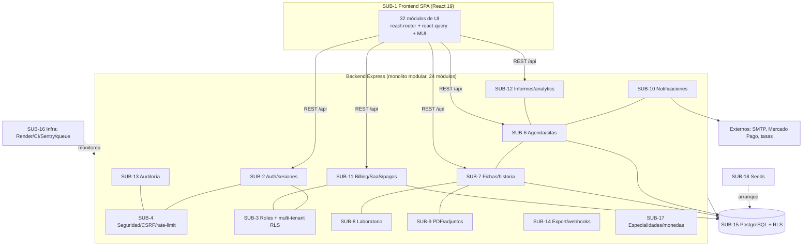

# Fase 1 — Mapa de subsistemas (Etapa 1: mapa inicial)

> **Estado:** INICIAL — identificación de dominios a partir de estructura real (`src/modules`, `frontend/src/modules`, `src/middlewares`, `src/shared`, `db/`). Responsabilidades detalladas: **Etapa 2**.
> **Regla:** un subsistema NO equivale a una carpeta; aquí se agrupan carpetas con evidencia de cohesión. Cada entrada marca su estado de análisis.

## Mapa de subsistemas

| ID | Subsistema | Evidencia principal (archivos) | Frontend | Estado |
|---|---|---|---|---|
| SUB-1 | **Interfaz web (SPA)** | `frontend/src/main.tsx`, `src/app/router/AppRouter.tsx`, `frontend/src/modules/*` (32) | — | identificado |
| SUB-2 | **Identidad, sesiones y autenticación** | `src/modules/auth/*` (auth.routes/controller/service/schema), `src/shared/{jwt,sessions,crypto}.service.ts`, `src/middlewares/auth.middleware.ts`, `src/middlewares/sessionActivity.middleware.ts` | `frontend/src/modules/{auth,2fa}` | identificado |
| SUB-3 | **Autorización, roles y multi-tenancy** | `src/middlewares/{tenant,feature}.middleware.ts`, `src/shared/multi-tenant.service.ts`, `src/shared/ownership.ts`, RLS en `db/` | `frontend/src/modules/{settings,tenants}` (parcial) | identificado |
| SUB-4 | **Seguridad y protección de peticiones** | `src/middlewares/{security,csrf,requestLogger,correlationId}.middleware.ts`, rate limiters en `src/app.ts:197-252` | — | identificado |
| SUB-5 | **Usuarios, doctores y pacientes** | `src/modules/doctor/*`; identidad en `users` (rol); CRUD de personas en `doctor` (tenant) y `super-admin` (global); **no** hay módulo `users`/`patients` | `frontend/src/modules/{users,doctors,patients,management}` | ✅ revisado (Etapa 2) — pacientes = `users` con `role IN ('user','patient')` |
| SUB-6 | **Agenda, disponibilidad y citas** | `src/modules/{booking,availability,calendar,holidays,guest,waitlist}/*` | `frontend/src/modules/{bookings,availability,calendar?,waitlist}` | identificado |
| SUB-7 | **Historia clínica y fichas** | `src/modules/{clinical-record,clinical-templates,medical-history}/*`, `src/modules/laboratory` | `frontend/src/modules/{clinical-records,clinical-templates,medical-history,clinical}` | identificado |
| SUB-8 | **Laboratorio** | `src/modules/laboratory/*`, migraciones 002-005, 010, 028 | `frontend/src/modules/laboratory` | identificado |
| SUB-9 | **Documentos, PDF y adjuntos** | `src/modules/attachments/*`, `pdfkit` (prescription/lab/report PDF services en tests) | `frontend/src/modules/attachments` | identificado |
| SUB-10 | **Notificaciones y recordatorios** | `src/modules/notifications/*`, `src/jobs/reminder.job.ts`, `src/shared/email.service.ts` | `frontend/src/modules/notifications` | identificado |
| SUB-11 | **Facturación, billing y SaaS (suscripciones, pagos)** | `src/modules/{billing,saas,currencies}/*`, `src/shared/mercadopago.service.ts`, migración 030-031 | `frontend/src/modules/{billing,saas,tenants}` | identificado |
| SUB-12 | **Informes, analítica y métricas** | `src/modules/{analytics,reports}/*`, `src/shared/metrics.service.ts`, `/metrics` | `frontend/src/modules/{analytics,reports,dashboard}` | identificado |
| SUB-13 | **Auditoría e integridad** | `src/modules/audit/*`, `src/jobs/audit-integrity.job.ts`, `AUDIT_HMAC_SECRET` | `frontend/src/modules/audit` | identificado |
| SUB-14 | **Portabilidad de datos y webhooks** | `src/modules/{data-portability,webhooks}/*`, migración 017 | — | identificado |
| SUB-15 | **Base de datos y acceso a datos** | `src/shared/{db,query,multi-tenant}.ts`, `db/{init.sql,migrations/}`, runner en `src/app.ts:301` | — | identificado |
| SUB-16 | **Infraestructura, operación y observabilidad** | `src/shared/{sentry,queue,cleanup,metrics}.service.ts`, `render.yaml`, `Dockerfile*`, `.github/workflows/*`, `scripts/backup*` | — | identificado |
| SUB-17 | **Especialidades y catálogos** | `src/modules/specialties/*`, `src/modules/currencies/*` | `frontend/src/modules/specialties` | identificado |
| SUB-18 | **Semillas y arranque de datos** | `src/seed/*` (excluido de cobertura) | — | identificado |
| SUB-19 | **Onboarding y landing** | `frontend/src/modules/{landing,onboarding,legal}`, `landing-vitaria.html`, **backend:** `src/modules/saas/{saas.routes.ts,saas.controller.ts,saas.service.ts(§onboardTenant),onboarding.service.ts,onboarding.schema.ts}` | idem | ✅ revisado (Etapa 2) — backend asociado = `src/modules/saas` (onboarding) |

**Dominios del enunciado SIN evidencia todavía (no asumir que existen):** super-admin ya existe como módulo (`src/modules/super-admin`) → integrado en SUB-3/SUB-11. No se detectó módulo de "ML" en `src/modules` (la wiki menciona `06-MACHINE-LEARNING` — verificar si es aspiracional).

## Diagrama de subsistemas (nivel lógico)

## Siguientes unidades (prioridad Etapa 2)

1. **SUB-2 Auth/sesiones** (crítico, flujos de seguridad) → `subsystems/auth/`
2. **SUB-3 Multi-tenancy + RLS** (riesgo máximo en SaaS) → `subsystems/multi-tenancy/`
3. **SUB-6 Agenda/citas** (dominio central del producto) → `subsystems/booking/`
4. **SUB-7 Historia clínica** → `subsystems/clinical/`
5. SUB-4 seguridad, SUB-11 billing, SUB-15 datos, SUB-1 frontend…

> Resolver antes: ¿dónde están CRUD de **usuarios** y **pacientes**? (posible hallazgo de dispersión).
