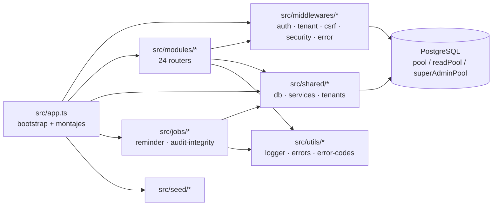

# 03 — Grafo de dependencias y catálogos

> **Estado:** ✅ completado (Fase 3) · **Ámbito:** backend `src/**` + frontend `frontend/src/**` (excluye tests, `node_modules`, `frontend-v3`).
> **Método:** análisis estático de imports relativos (`from './…'`) agregados a nivel de grupo; evidencia por archivo en `catalog/dependencies.csv` (selección de seam) y `catalog/symbols.csv` (superficie exportada).
> **Certeza:** confirmado salvo indicación contraria. Nodos `(other)` = archivos raíz de `src/` (`app.ts`, `server.ts`, `config`, etc.).

## 1. Grafo de arranque (backend)

Flujo de una petición: `app.ts` (seguridad → JSON → CSRF → `optionalAuth` → `tenantMiddleware`) → router de módulo → `authMiddleware`/`authorize` → `validateZod` → controller → service → `db.ts` (`tenantContext` + pool). Detalle en `subsystems/*/flows.md`.

## 2. Aristas entre módulos backend (excluye `shared`/`middlewares`/`utils`)

Dependencias directas **módulo→módulo** detectadas por import estático (134 aristas totales; las de abajo son las no transversales):

| Origen | Depende de | Tipo |
|---|---|---|
| `auth` | `doctor`, `seed` | runtime + data |
| `analytics` | `doctor` | runtime |
| `attachments` | `doctor` | runtime |
| `availability` | `doctor` | runtime |
| `billing` | `doctor` | runtime |
| `booking` | `doctor`, `notifications`, `waitlist` | runtime |
| `clinical-record` | `doctor` | runtime |
| `clinical-templates` | — | (solo transversales) |
| `doctor` | `specialties` | runtime |
| `guest` | `doctor` | runtime |
| `holidays` | `waitlist` | runtime |
| `laboratory` | `doctor`, `notifications` | runtime |
| `medical-history` | `doctor` | runtime |
| `waitlist` | `notifications` | runtime |
| `middlewares` | `saas` (`feature.middleware` → `checkFeatureAccess`) | runtime |
| `saas` | — | (solo transversales) |

**Observaciones AS-IS:**
- `doctor` es el módulo más acoplado (destino de `auth`, `analytics`, `attachments`, `availability`, `billing`, `booking`, `clinical-record`, `guest`, `laboratory`, `medical-history`). Actúa como núcleo de identidad profesional aunque SUB-5 confirmó que **no** existe módulo `users`/`patients` propio.
- Existe dependencia **middleware→módulo** (`feature.middleware.ts:7` → `saas.service.ts`), inversión de capas: la capa de middleware conoce un dominio de negocio.
- Cadena de notificaciones: `booking`/`laboratory`/`waitlist` → `notifications`.
- **No se detectaron ciclos** entre módulos de negocio en el análisis estático.

## 3. Aristas entre módulos frontend (excluye `shared`/`app`/`i18n`)

| Origen | Depende de | Tipo |
|---|---|---|
| `doctors` | `clinical-records`, `laboratory` | componente/página |
| `medical-history` | `clinical-records`, `laboratory` | componente/página |

El resto de módulos frontend solo dependen de `shared` (api-client, hooks, UI), `app` (router, providers) e `i18n`. `landing` → `shared/hooks/usePricing` → `shared/services/pricing.service`. **32 módulos frontend** en total.

## 4. Hubs transversales (fan-in)

| Hub | Consumido por | Nota |
|---|---|---|
| `src/shared/db.ts` | `app`, `middlewares`, casi todos los módulos, `jobs`, `shared` | `pool`/`readPool`/`superAdminPool` + `tenantContext` (AsyncLocalStorage) |
| `src/shared/*` (servicios) | 24/24 módulos | `jwt`, `sessions`, `crypto`, `email`, `currencies`, `multi-tenant`, `ownership`, `mercadopago`, `queue`, `metrics`, `sentry` |
| `src/middlewares/*` | 24/24 módulos | `authMiddleware`, `authorize`, `validateZod`, `feature.middleware` |
| `src/utils/*` | 24/24 módulos | `logger`, `errors`, `error-codes` |
| `frontend/src/shared/services/api-client.ts` | módulos frontend | Axios + refresh + CSRF |

## 5. Dependencias externas

**Backend — runtime (30):** `express`, `pg`, `zod`, `jsonwebtoken`, `bcrypt`, `helmet`, `cors`, `compression`, `cookie-parser`, `hpp`, `sanitize-html`, `express-rate-limit`, `nodemailer`, `@sendgrid/mail`, `pdfkit`, `prom-client`, `node-cron`, `@sentry/node`, `winston`, `dotenv`, `hi-base32`.
**Backend — dev (6):** `typescript`, `tsx`, `vitest`, `@vitest/coverage-v8`, `supertest`, `@types/supertest` (+ `@types/*`).
**Frontend — runtime (26):** `react` 19, `react-dom`, `react-router-dom`, `@mui/material` + `@emotion/*`, `@tanstack/react-query`, `@tanstack/react-table`, `axios`, `react-hook-form`, `zod`, `i18next` + `react-i18next`, `date-fns`, `recharts`, `@fullcalendar/*`, `framer-motion`, `react-hot-toast`, `react-google-recaptcha`.
**Frontend — dev (13):** `vite`, `@vitejs/plugin-react-swc`, `typescript`, `vitest`, `@vitest/coverage-v8`, `@testing-library/react`, `jsdom`, `@types/react*`.

> **Nota:** `MercadoPago` se consume por `fetch` crudo (sin SDK) — ver `subsystems/billing`. `TWILIO_*` aparece en `.env.example` pero **no** hay dependencia ni import de Twilio (ver `05-findings.md`). `@sentry/node` (backend) sin contraparte `@sentry/react` en el frontend (FND-R4).

## 6. Contratos frontend → backend

Nodos de acoplamiento por HTTP (no import): `shared/services/*.service.ts` del frontend → rutas `ROUTE-*` de `catalog/endpoints.csv`. Ejemplos verificados: `api-client.ts:66-74` → `POST /api/auth/refresh`; `shared/services/pricing.service.ts` → `GET /api/currencies/rates`. Matriz completa funcionalidad→endpoint en `06-test-coverage.md` y `catalog/endpoints.csv`.

## 7. Acceso a datos (resumen)

Matriz completa archivo→tabla→operación en `catalog/database-access.csv` (**331 filas**; 178 `select`, 90 `insert`, 45 `update`, 18 `delete`).

- **46 de 49 tablas** son referenciadas en `src/**`.
- **3 tablas NO referenciadas en código** (solo definidas en migraciones/DDL): `insurance_claims`, `lab_result_history`, `webhook_deliveries`. `webhook_deliveries` concuerda con FND-N5 (nunca escrita); las otras dos son candidatas a tabla muerta o uso exclusivamente externo.
- Tabla `ml_demand_forecast` **existe** en el esquema (existe un artefacto de ML a nivel datos aunque no haya código de entrenamiento en `src/modules`).

## 8. Catálogos (estado)

| Catálogo | Filas | Estado |
|---|---|---|
| `catalog/files.csv` | 610 | ✅ |
| `catalog/modules.csv` | 57 | ✅ |
| `catalog/endpoints.csv` | 219 | ✅ |
| `catalog/dependencies.csv` | 44 | ✅ (selección de seam) |
| `catalog/symbols.csv` | 1483 (759 backend · 724 frontend) | ✅ |
| `catalog/database-access.csv` | 331 | ✅ |

## 9. NO VERIFICADO

- Resolución de imports por *path alias* (`tsconfig paths`) — el análisis usa rutas relativas; alias `@` del frontend (`vite.config.ts`) podría ocultar aristas adicionales.
- Dependencias en tiempo de ejecución vía inyección/eventos (no estáticas).
- Grafo a nivel de símbolo completo (aquí agregado a nivel de módulo; export surface en `symbols.csv`).

---

> Tags: #dependencias #grafo #catalogos · Ver: [`05-findings.md`](05-findings.md) · [`04-cross-cutting-concerns.md`](04-cross-cutting-concerns.md)
