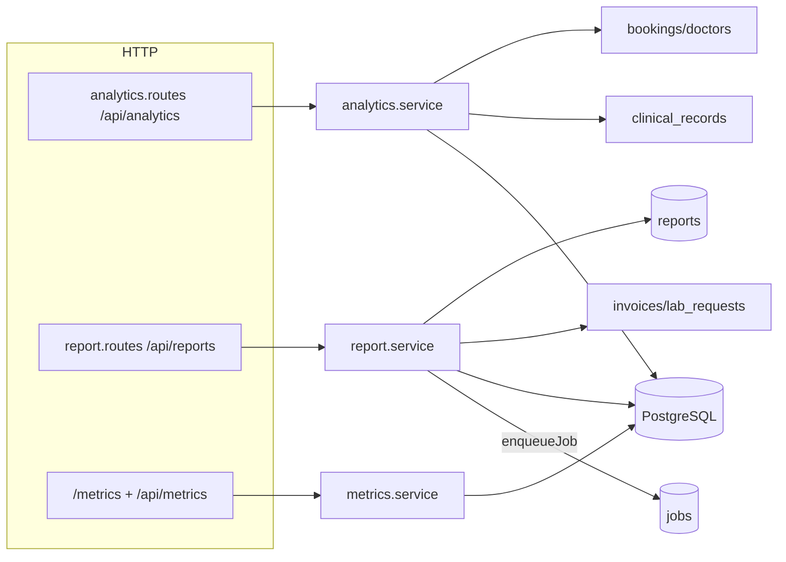
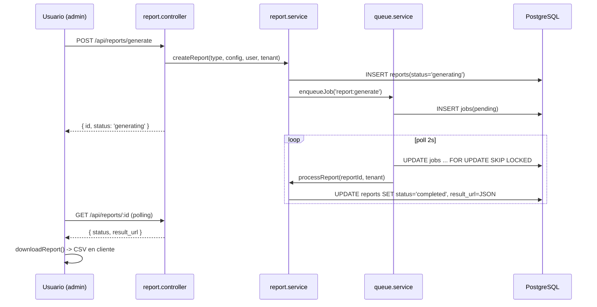
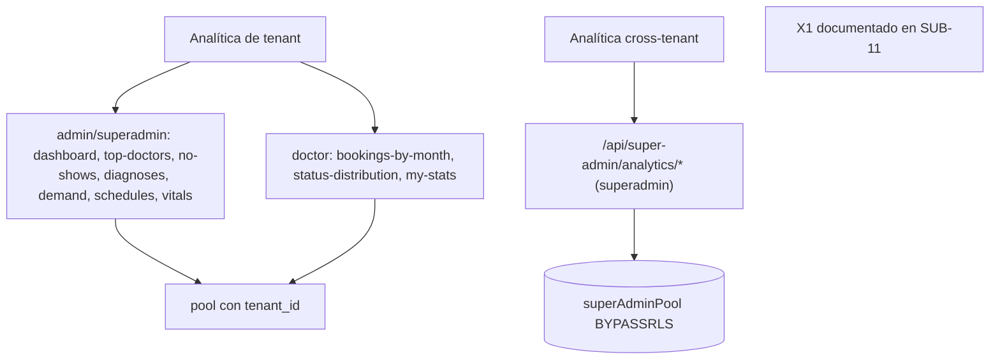
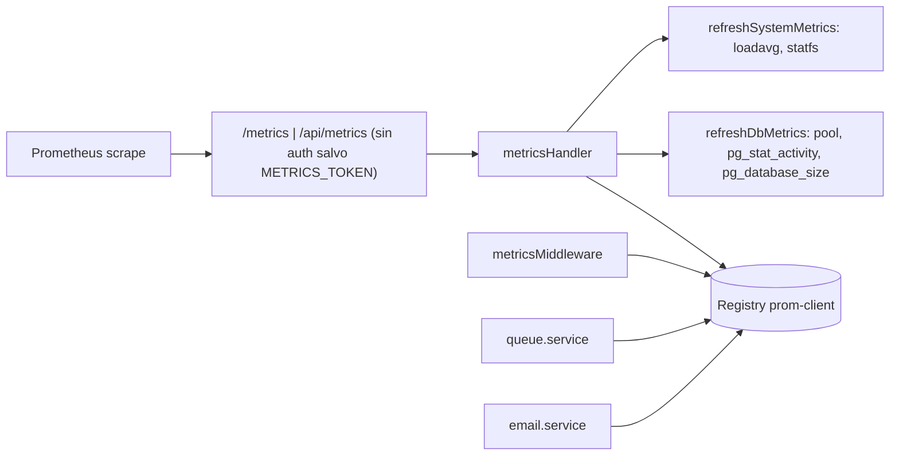

# SUB-12 — Diagramas

> Formato Mermaid (decisión D-1: `diagram-design` no disponible). Fuente: `src/modules/analytics/*`, `src/modules/reports/*`, `src/shared/metrics.service.ts`, `src/shared/queue.service.ts`, `src/app.ts`.

## D1. Módulos y fuentes de datos

## D2. Pipeline asíncrono de informes

## D3. Analítica: tenant vs cross-tenant

## D4. Superficie de métricas

