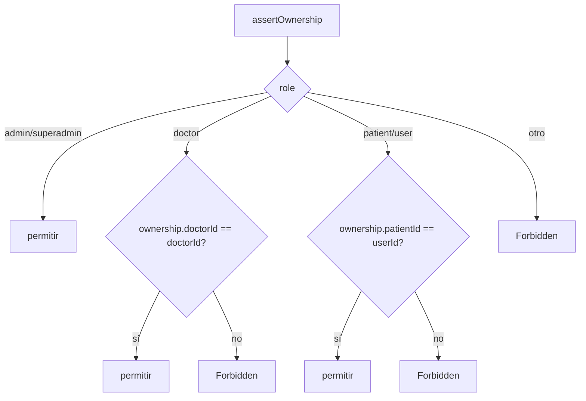
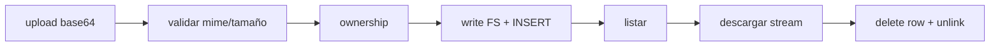
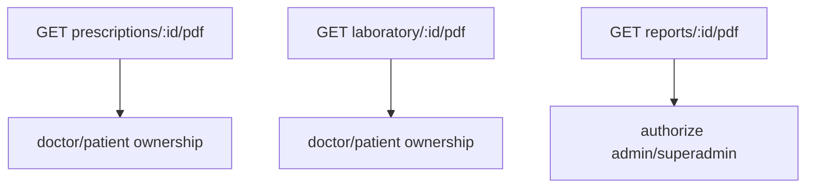

# SUB-9 — Diagramas

> Contexto: `[[../../01-system-context]]` · Clinical: `[[../clinical/overview]]` · Laboratorio: `[[../laboratory/overview]]`

## D1. Módulos, entidades y almacenamiento

```mermaid
flowchart TD
  R[attachments.routes] --> C[attachments.controller] --> S[attachments.service]
  S --> DB[(attachments)]
  S --> FS[(UPLOAD_DIR/&lt;tenant&gt;/)]
  C --> DOC[doctor.service.getDoctorByUserId]
  S -.ownership.-> E{clinical_record|prescription|lab_result|booking|medical_history|patient}
  subgraph PDF
    CP[prescription-pdf] --> PK[pdfkit]
    LO[lab-order-pdf] --> PK
    RP[report-pdf] --> PK
  end
```

## D2. Verificación de ownership (anti-IDOR)



## D3. Ciclo de vida de un adjunto



## D4. Rutas PDF y su control de acceso


