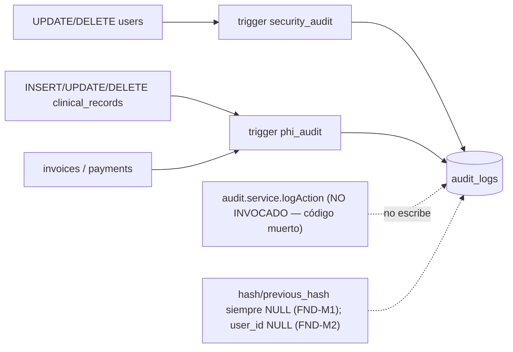
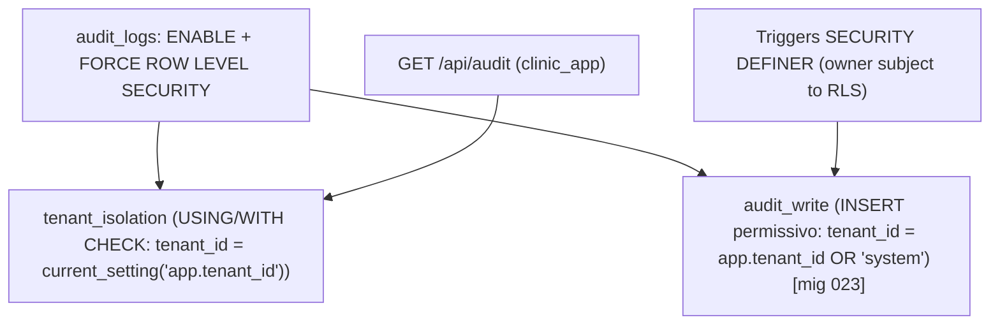
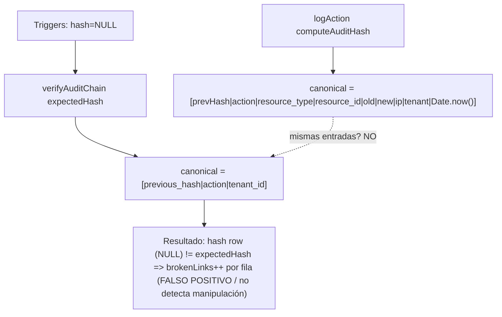
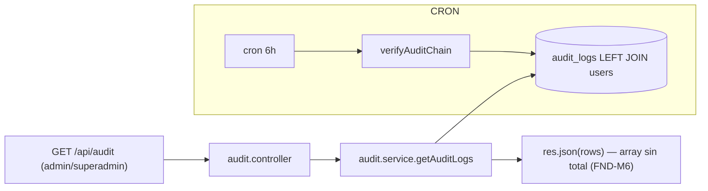

# SUB-13 — Diagramas

> Formato Mermaid (decisión D-1). Fuente: `src/modules/audit/*`, `src/jobs/audit-integrity.job.ts`, `src/shared/crypto.service.ts`, `db/security.sql`, `db/migrations/023_fix_audit_rls.sql`.

## D1. Escritores de `audit_logs`

## D2. RLS y políticas de `audit_logs`

## D3. Cadena HMAC: escritura vs verificación (desalineadas)

## D4. Superficie de lectura de auditoría

