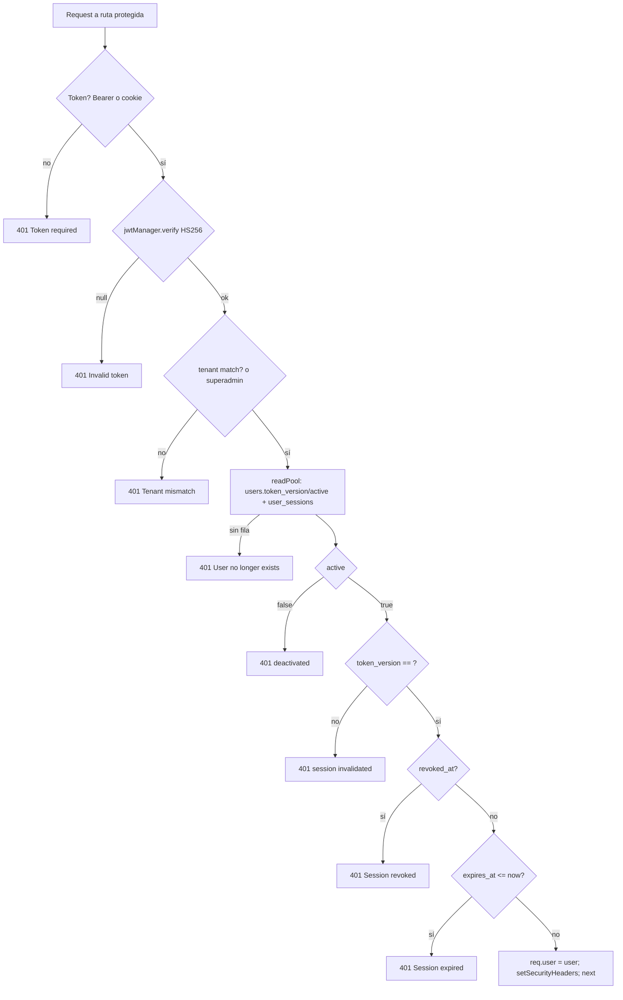

# SUB-2 — Diagramas

## D1 · Secuencia: Login exitoso

```mermaid
sequenceDiagram
    autonumber
    participant B as Navegador (AuthProvider)
    participant API as Express (auth.routes)
    participant CTL as auth.controller
    participant SVC as auth.service
    participant DB as PostgreSQL (pool tenant)
    SA as superAdminPool (BYPASSRLS)

    B->>API: POST /api/auth/login {email,password,totp?,captcha?}
    API->>API: authLimiter → CSRF → optionalAuth → tenantMiddleware
    API->>API: validateZod(loginSchema)
    API->>CTL: login(req)
    CTL->>SVC: login(payload, tenant_id)
    SVC->>SVC: verifyCaptcha()
    SVC->>DB: BEGIN; set_config(app.tenant_id)
    SVC->>SA: SELECT user por email+tenant
    SA-->>SVC: user (o null)
    SVC->>SVC: bcrypt.compare(password)
    alt password inválido
        SVC->>DB: UPDATE failed_attempts++ (luego ROLLBACK — FND-A1)
        SVC-->>CTL: throw 400 AUTH_INVALID_CREDENTIALS
    else password válido
        SVC->>SVC: check active / locked / TOTP
        SVC->>DB: INSERT user_sessions RETURNING id
        SVC->>DB: INSERT refresh_tokens (hash, family, session_id)
        SVC->>DB: COMMIT
        SVC->>SVC: generateAccessToken(HS256,15m,sid)
        SVC->>DB: SELECT tenants.currency/country
        SVC-->>CTL: {access,refresh,user}
        CTL->>B: Set-Cookie access(15m)+refresh(30d); 200 JSON
    end
```

## D2 · Secuencia: Refresh con rotación y detección de reuso

```mermaid
sequenceDiagram
    autonumber
    participant B as api-client (axios)
    participant API as auth.controller.refresh
    participant SVC as auth.service.refreshToken
    participant DB as PostgreSQL

    B->>API: POST /auth/refresh (cookie refresh_token, X-CSRF-Token)
    API->>SVC: refreshToken({refresh_token})
    SVC->>DB: BEGIN; SELECT * FROM refresh_tokens WHERE token=$1 FOR UPDATE
    alt token no existe / expirado
        SVC-->>API: null
    else token ya revocado
        SVC->>DB: SELECT sibling válido (misma family+session)
        alt sibling fresco (< REUSE_GRACE 30s)
            SVC->>SVC: benign race → rotar sibling
        else
            SVC->>DB: revokeFamilyForSession (family + user_sessions.revoked_at)
            SVC-->>API: null (reuse detection)
        end
    end
    SVC->>DB: validar user activo + token_version
    SVC->>DB: validar session (revoked/expires/idle)
    SVC->>DB: UPDATE revoked=true (token presentado)
    SVC->>DB: INSERT nuevo refresh_tokens (misma family)
    SVC->>DB: UPDATE last_seen_at / last_activity_at; COMMIT
    SVC-->>API: {access,refresh,user}
    API->>B: set cookies + 200 (o clear cookies + 401)
```

## D3 · Flujo: verificación por request (`authMiddleware`)



## D4 · Componentes: consumo frontend

```mermaid
flowchart LR
    LP[LoginPage] -->|login()| AP[AuthProvider/useAuth]
    AP -->|axios| AC[api-client]
    AC -->|401| AC2{refreshSession}
    AC2 -->|POST /auth/refresh| BE[(Backend /api/auth)]
    AC -.->|BroadcastChannel| TABS[Otras pestañas]
    AC -->|X-CSRF-Token| BE
    AP -->|hasPermission| RU[role.utils + permissions]
    AP -->|logout| BE
```
