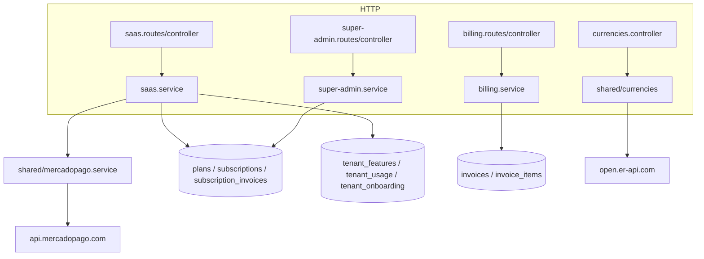
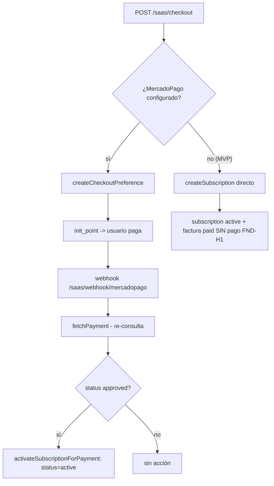
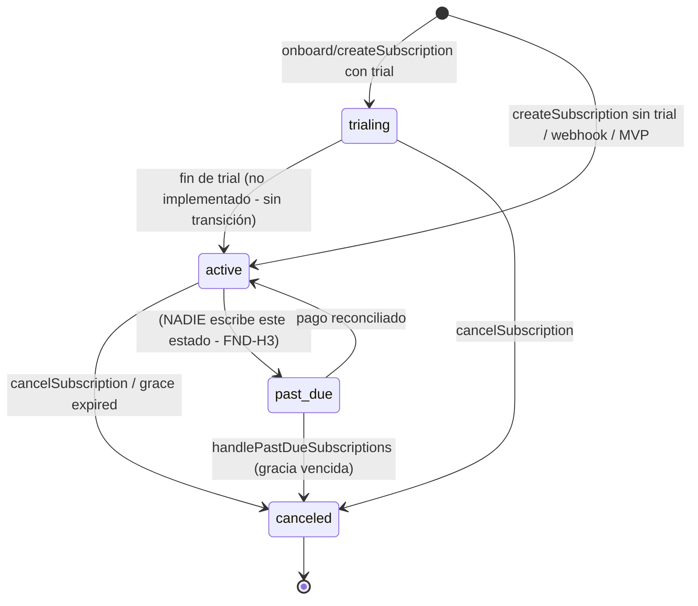
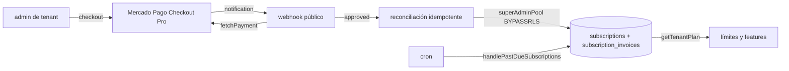

# SUB-11 — Diagramas

Índice de diagramas (Mermaid) del subsistema Billing / SaaS.

> Vista de datos: `[[../database/overview]]` · Multi-tenancy: `[[../multi-tenancy/overview]]` · Contexto: `[[../../01-system-context]]`

## D1. Módulos y tablas

## D2. Activación de suscripción (dos caminos)

## D3. Ciclo de vida de suscripción (estados)

## D4. Infraestructura de cobro y reconciliación

