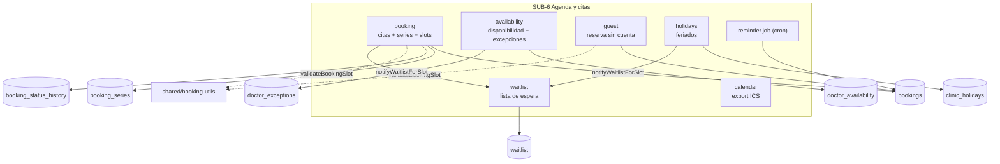
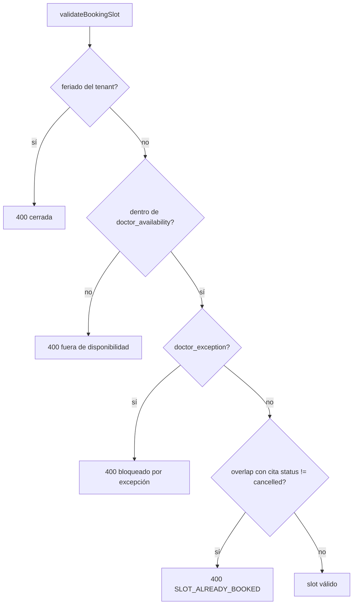
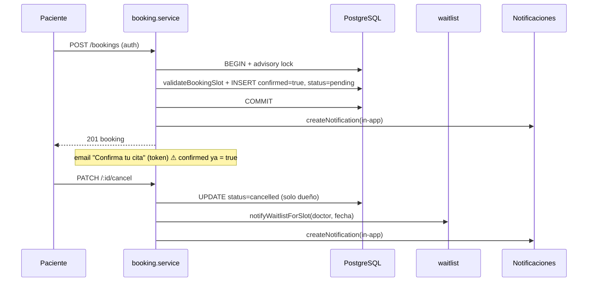
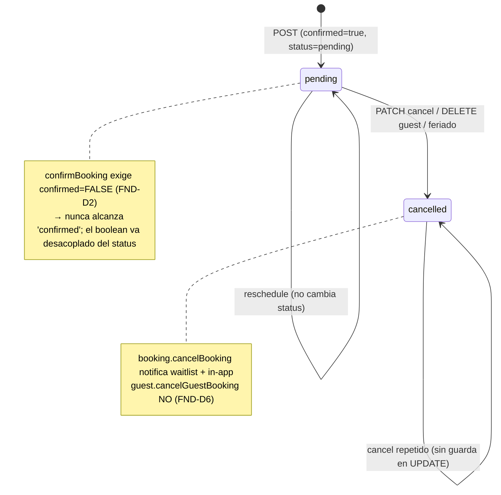

# SUB-6 — Diagramas (Mermaid)

> Herramienta `diagram-design` no disponible ⇒ Mermaid (decisión D-1).

## D1. Mapa de módulos, jobs y tablas

## D2. Validación de slot (fuente única `booking-utils`)

## D3. Crear / confirmar / cancelar cita — actores y efectos

## D4. Ciclo de vida de la cita (estado implícito)

