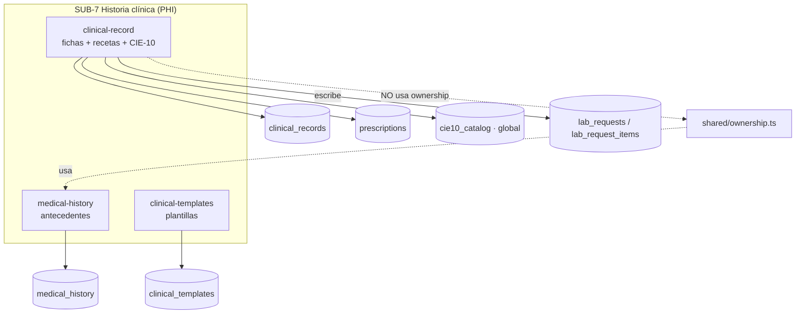
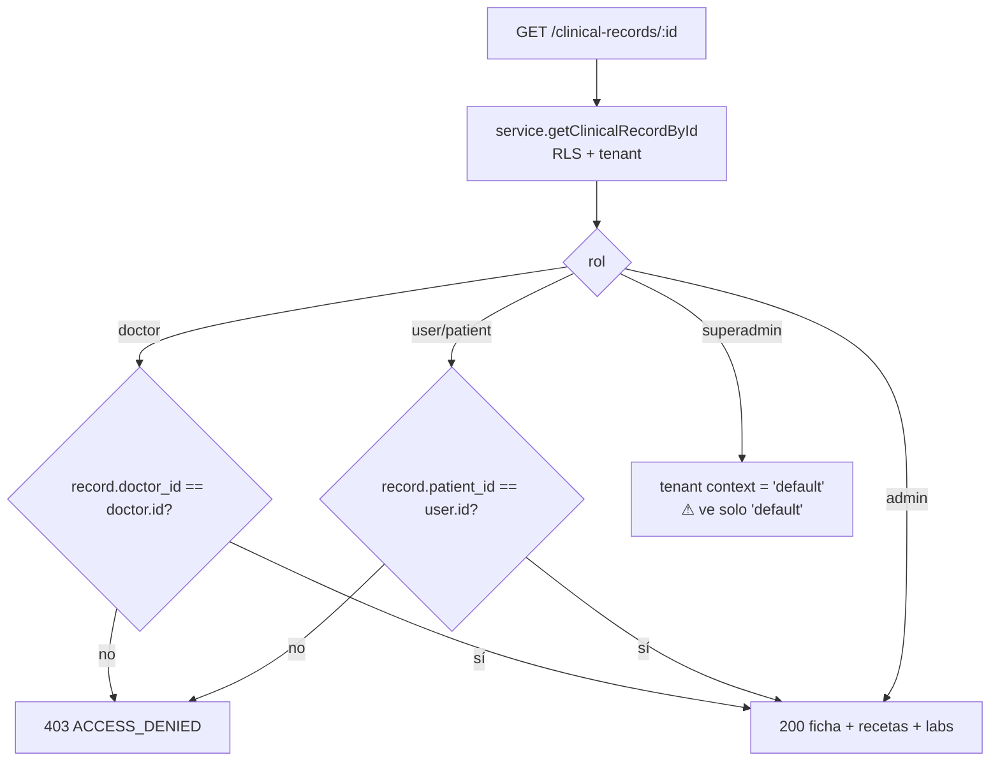
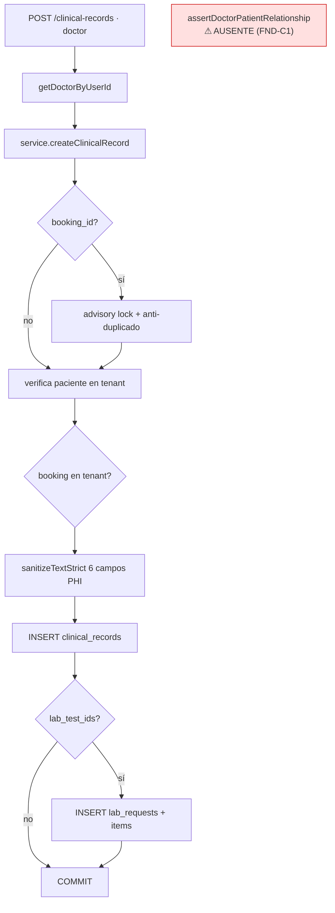
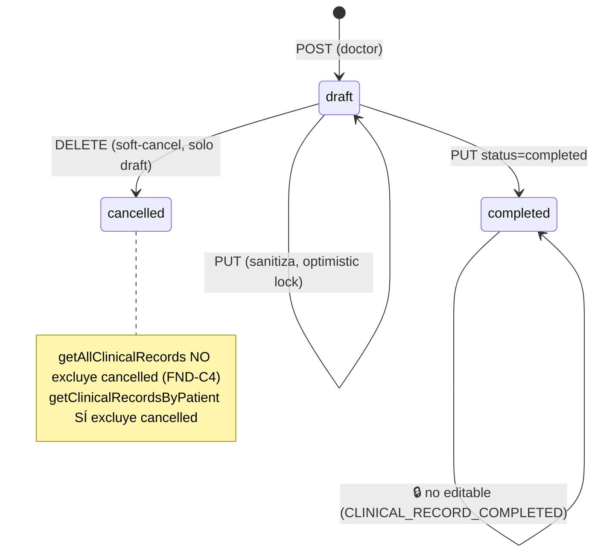

# SUB-7 — Diagramas (Mermaid)

> Herramienta `diagram-design` no disponible ⇒ Mermaid (decisión D-1).

## D1. Mapa de módulos y tablas

## D2. Autorización por rol y relación (lectura de ficha)

## D3. Crear ficha — validaciones y hueco

## D4. Ciclo de vida de la ficha

