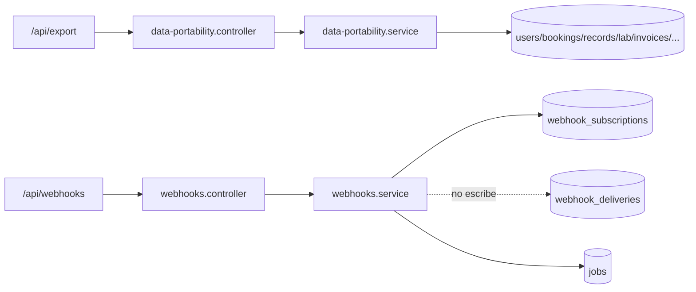
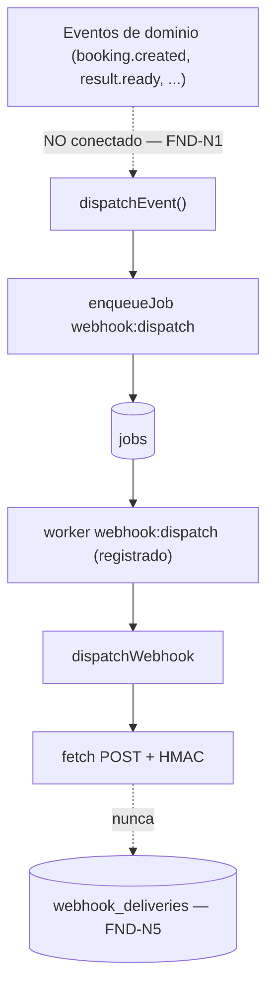
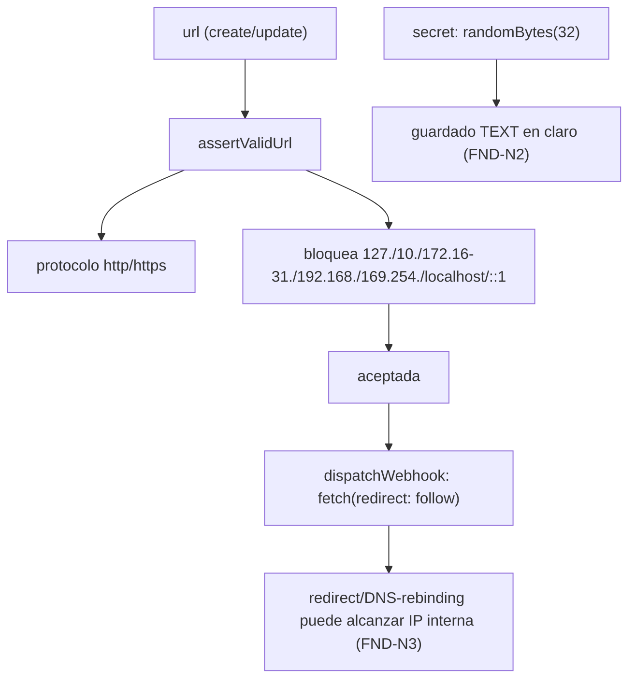
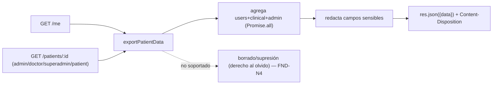

# SUB-14 — Diagramas

> Formato Mermaid (decisión D-1). Fuente: `src/modules/{data-portability,webhooks}/*`, `src/shared/queue.service.ts`, `db/init.sql`, `db/migrations/017_webhook_subscriptions.sql`.

## D1. Módulos, rutas y almacenamiento

## D2. Pipeline de webhooks (puntos muertos)

## D3. Seguridad de URLs (SSRF) y secreto

## D4. Export RGPD (AS-IS)

