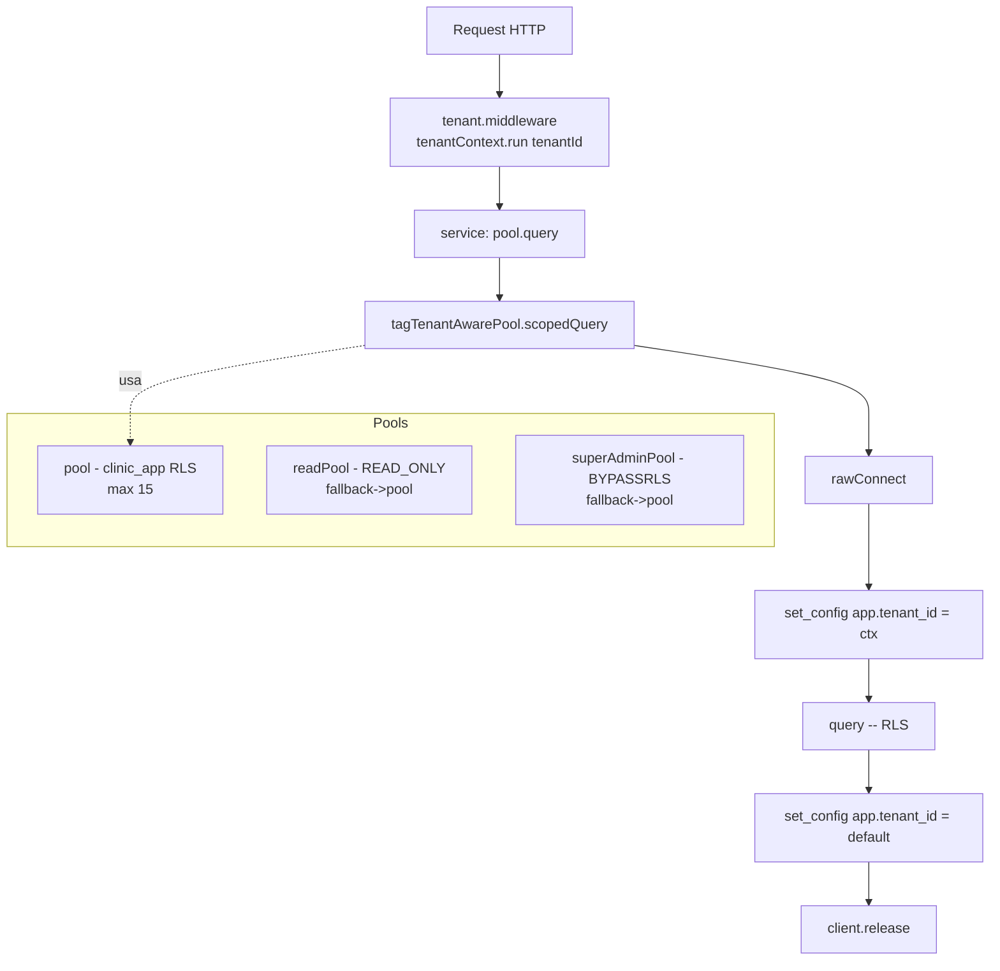
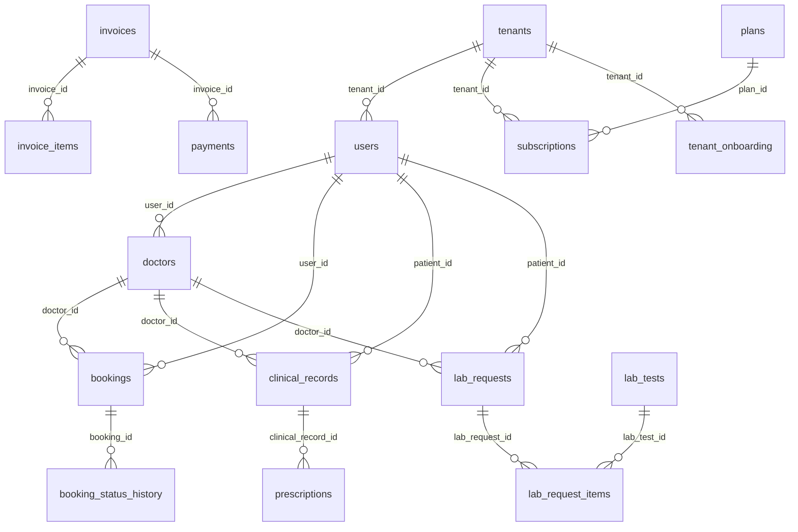
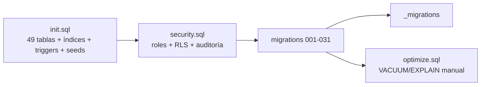
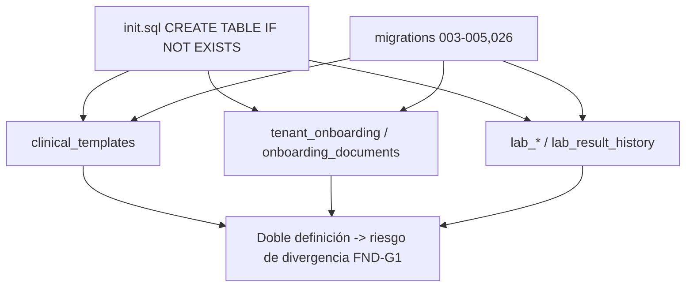

# SUB-15 — Diagramas

Índice de diagramas (Mermaid) del subsistema Base de datos / acceso a datos.

> Vista multi-tenant: `[[../multi-tenancy/overview]]` · Contexto: `[[../../01-system-context]]`

## D1. Pools, contexto y RLS

## D2. Familias de tablas y relaciones clave

## D3. Bootstrap de esquema

## D4. Drift de esquema (init.sql vs migraciones)

