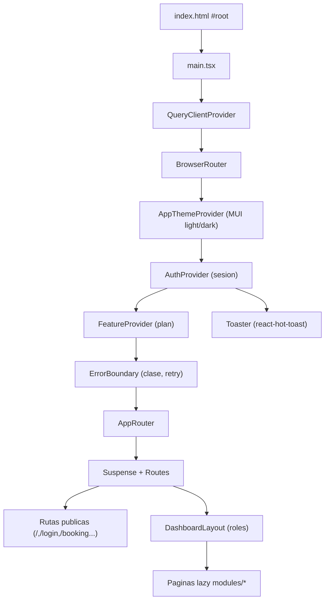
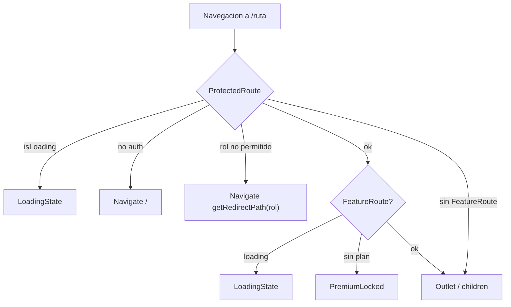
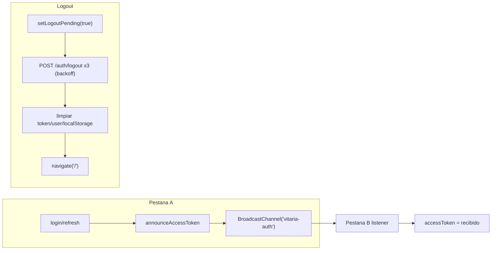

# SUB-1 — Diagramas (SPA Frontend)

## D1. Composición de providers y árbol de componentes



## D2. Ciclo de request autenticado con refresh (401)

```mermaid
sequenceDiagram
  participant C as Componente/hook
  participant AC as apiClient
  participant API as Backend /api
  C->>AC: request (Bearer en memoria + X-CSRF-Token)
  AC->>API: HTTP
  API-->>AC: 401
  AC->>AC: isRefreshing? encolar subscribers
  AC->>API: POST /auth/refresh (withCredentials + CSRF)
  alt refresh OK
    API-->>AC: access_token
    AC->>AC: announceAccessToken + reintentar original
    AC-->>C: respuesta 2xx
  else refresh falla
    AC->>AC: setAccessToken(null); subscribers(null)
    AC->>AP: onUnauthorized()
    AC-->>C: reject(error)
  end
```

## D3. Guardas de ruta (rol y plan)



## D4. Sesion multi-pestana y logout


