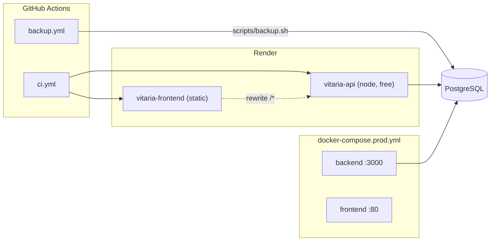
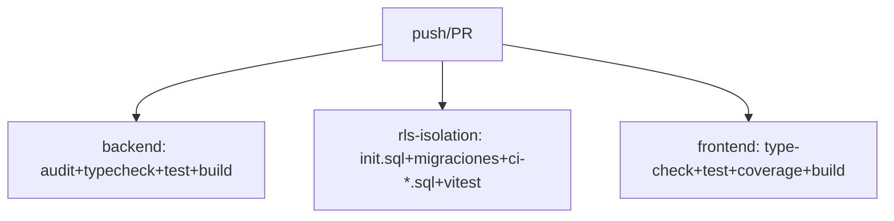
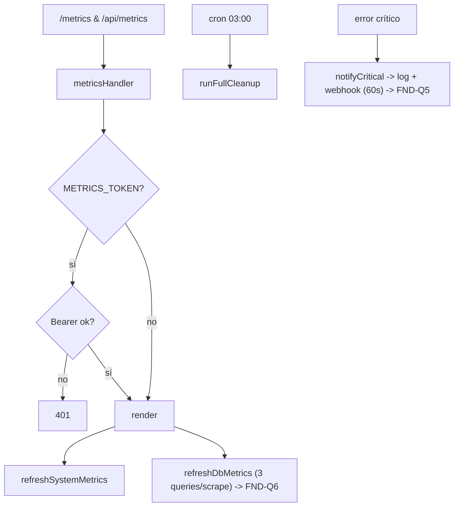
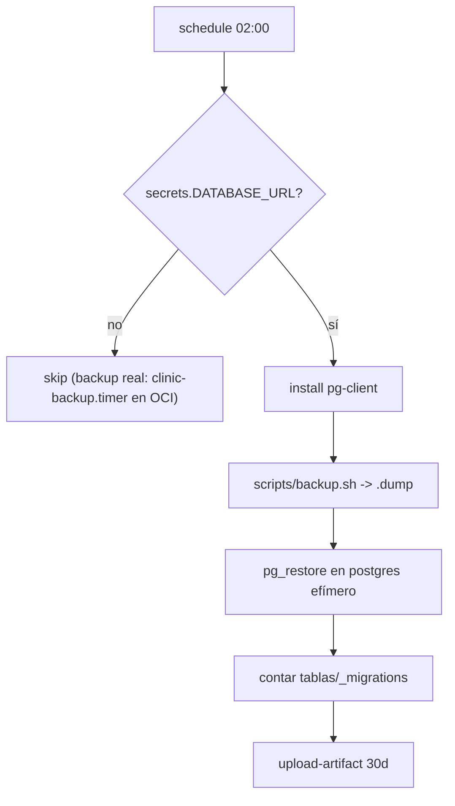

# SUB-16 — Diagramas

> Formato Mermaid (decisión D-1). Fuente: `Dockerfile`, `docker-compose*.yml`, `render.yaml`, `.github/workflows/*`, `src/shared/*.service.ts`.

## D1. Deploy topologies (Render + Docker)

## D2. Pipeline CI

## D3. Observabilidad y mantenimiento

## D4. Backup diario (con verificación)

