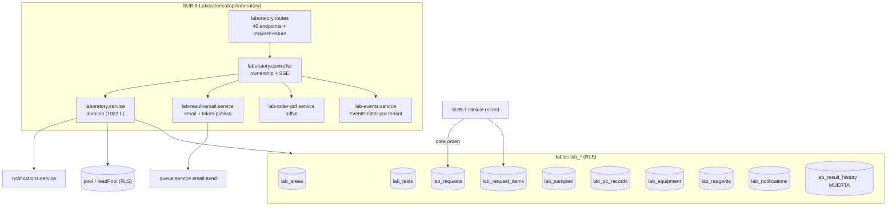
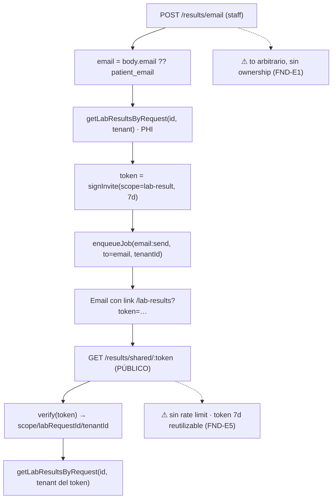

# SUB-8 — Diagramas (Mermaid)

> Herramienta `diagram-design` no disponible ⇒ Mermaid (decisión D-1).

## D1. Mapa de módulos, tablas y consumidores



## D2. Ciclo de vida de la orden/ítem (máquina de estados implícita)

```mermaid
stateDiagram-v2
  [*] --> pending: POST /laboratory
  pending --> received: muestras/estado manual
  received --> verified --> assigned --> processing
  processing --> qc_review
  qc_review --> result_entered
  processing --> validated_tech
  result_entered --> validated_tech
  validated_tech --> validated_doctor
  validated_doctor --> signed
  signed --> delivered
  pending --> cancelled: DELETE /:id
  pending --> rejected
  note right of result_entered
    PATCH /items/:id/result NO escribe 'result_entered' (FND-E2)
    → 'validated_tech' suele alcanzarse solo si el estado
      se fijó a mano (updateLabRequestItemStatus)
  end note
  note right of validated_tech
    updateLabRequestStatus / ItemStatus acepta CUALQUIER estado
    del CHECK sin validar transición (FND-E3)
  end note
```

## D3. Captura → validación → firma → entrega

```mermaid
sequenceDiagram
  participant D as Doctor
  participant T as Lab technician
  participant API as laboratory.service
  participant DB as PostgreSQL
  participant N as Notificaciones
  D->>API: PATCH /items/:id/result
  API->>DB: UPDATE result_value (status NO cambia) ⚠
  T->>API: PATCH /items/:id/validate-tech
  API->>DB: status IN (result_entered|processing)? → validated_tech
  D->>API: PATCH /items/:id/validate-doctor
  API->>DB: validated_tech → validated_doctor
  D->>API: PATCH /items/:id/sign
  API->>DB: validated_doctor → signed
  T->>API: PATCH /items/:id/deliver
  API->>DB: BEGIN → delivered; si no quedan ítems → orden delivered+completed_at → COMMIT
  API->>N: createNotification(paciente 'Resultados publicados')
```

## D4. Entrega pública de resultados (email + token)


