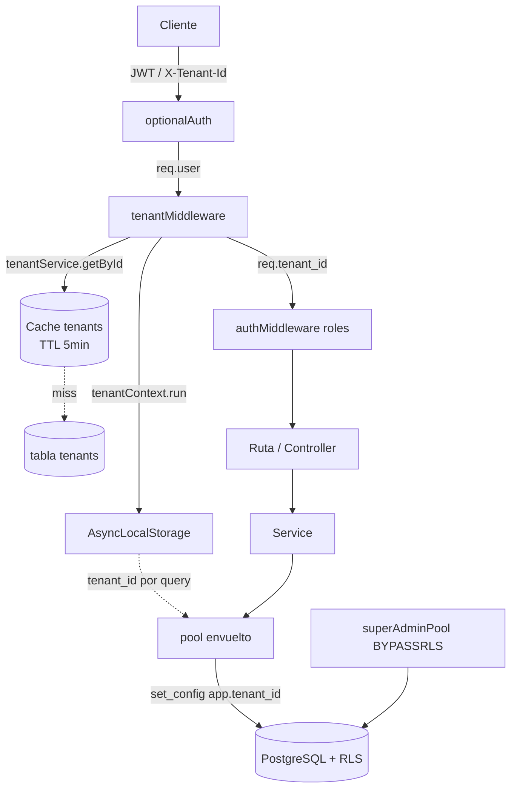
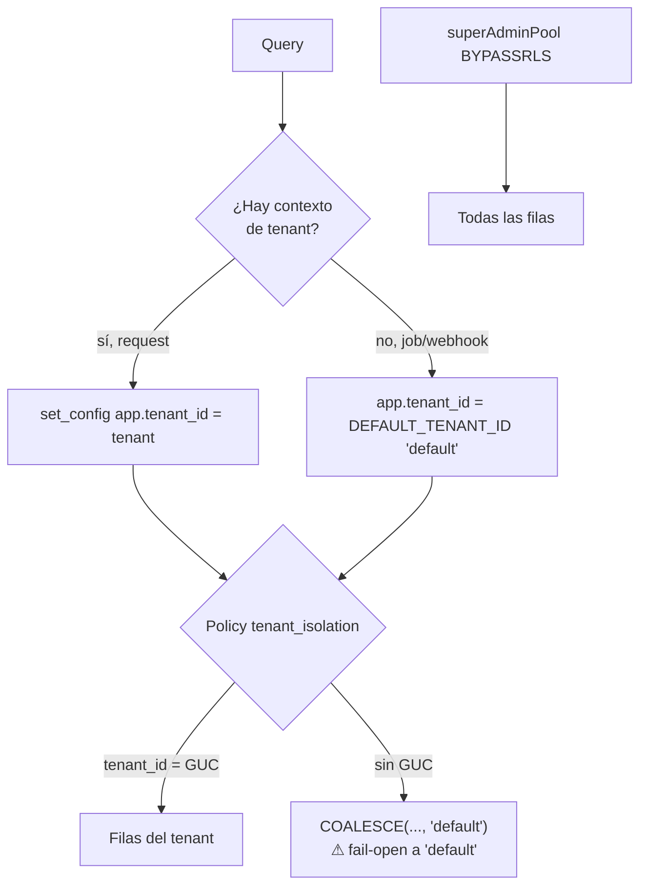
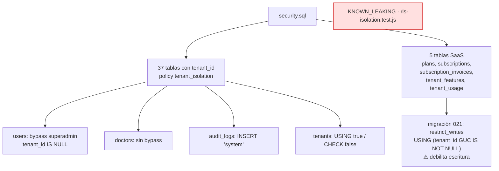

# SUB-3 — Diagramas (Mermaid)

> El MCP `diagram-design` no está disponible; se usa Mermaid (decisión D-1).

## D1. Aislamiento por request (capas)

## D2. Decisión de aislamiento (RLS vs fallback)

## D3. Modelo de pools y wrappers

```mermaid
flowchart LR
  subgraph App[Proceso Node]
    P[pool<br/>clinic_app · RLS]
    R[readPool<br/>DATABASE_URL_READ_ONLY]
    S[superAdminPool<br/>BYPASSRLS]
    TAG[tagTenantAwarePool]
  end
  TAG --> P
  TAG -.->|si hay READ_ONLY| R
  S -.->|sin wrapper| S
  P --> DB[(PostgreSQL)]
  R --> DB
  S --> DB
```

## D4. Tablas con RLS y excepciones

