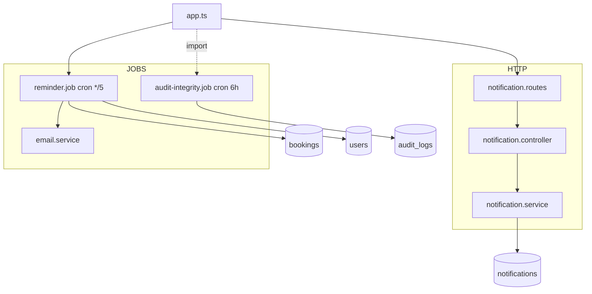
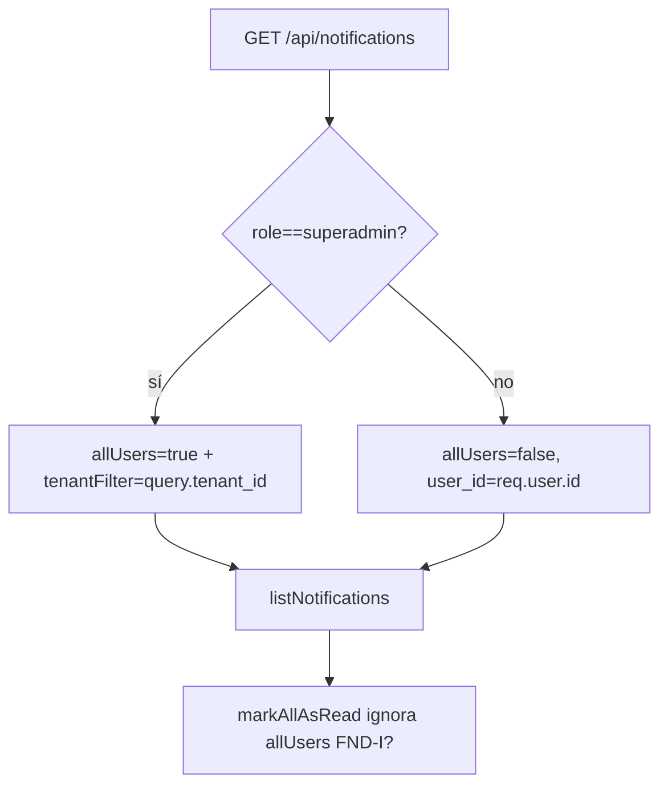
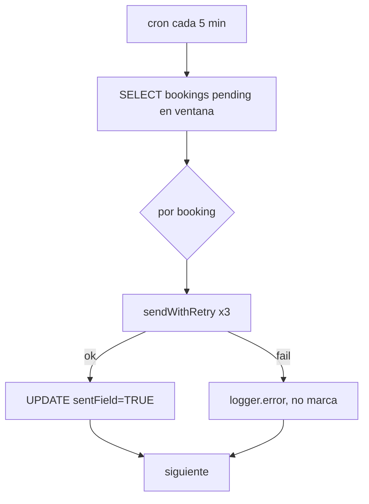
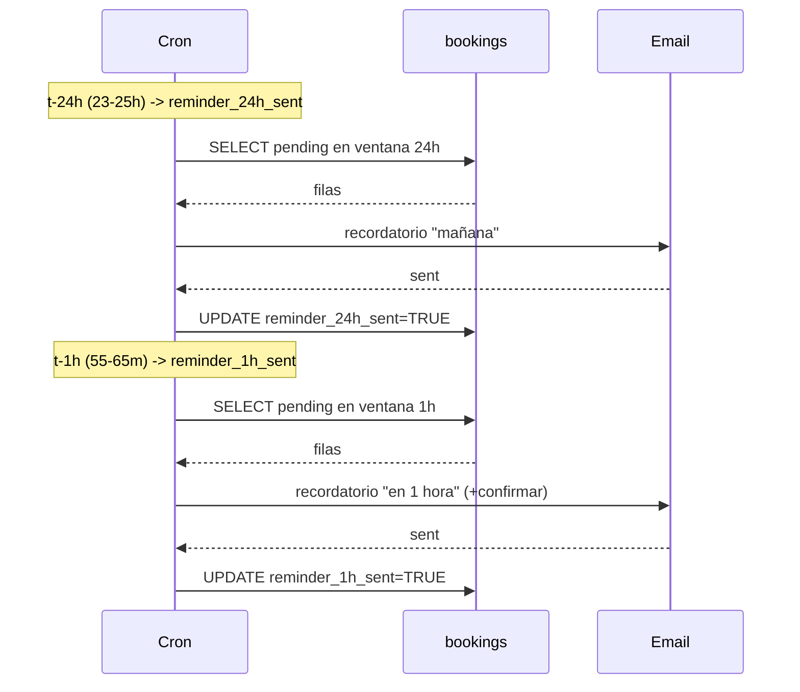

# SUB-10 — Diagramas

> Contexto: `[[../../01-system-context]]` · Booking: `[[../booking/overview]]` · Auditoría: `[[../audit/overview]]`

## D1. Módulos, jobs y tablas

## D2. Scope de notificaciones (usuario vs superadmin)

## D3. Ciclo del recordatorio

## D4. Cascada de recordatorios en el tiempo

