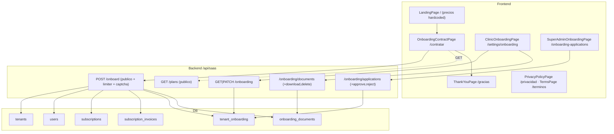
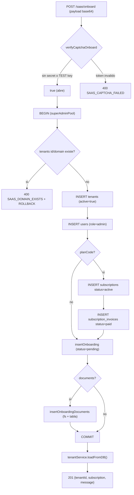
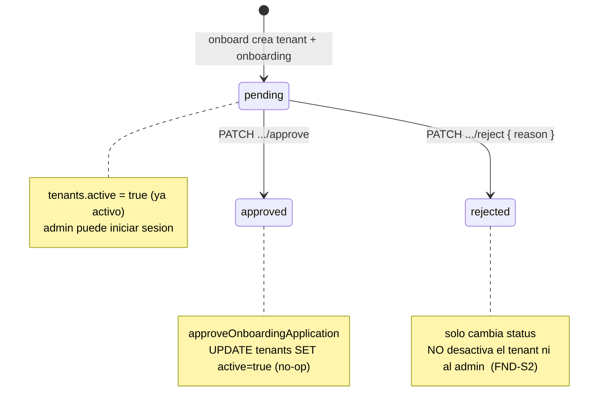
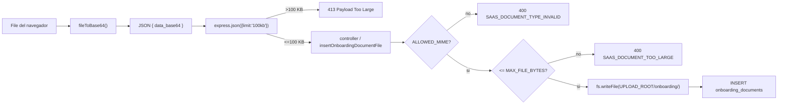

# SUB-19 — Diagramas (Onboarding público, aplicaciones y legal)

## D1. Módulos, rutas y tablas

## D2. Alta pública transaccional (`onboardTenant`)

## D3. Ciclo de la solicitud y su efecto real en el tenant

## D4. Carga de documentos en base64 y el límite del body

Nota: `MAX_FILE_BYTES` nunca se alcanza desde el formulario porque el body JSON (100 KB) corta
antes (base64 infla +33% ≈ 72 KB útiles). Ver FND-S4 / FND-K1.
