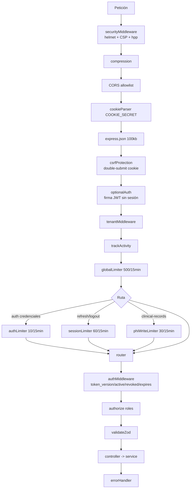
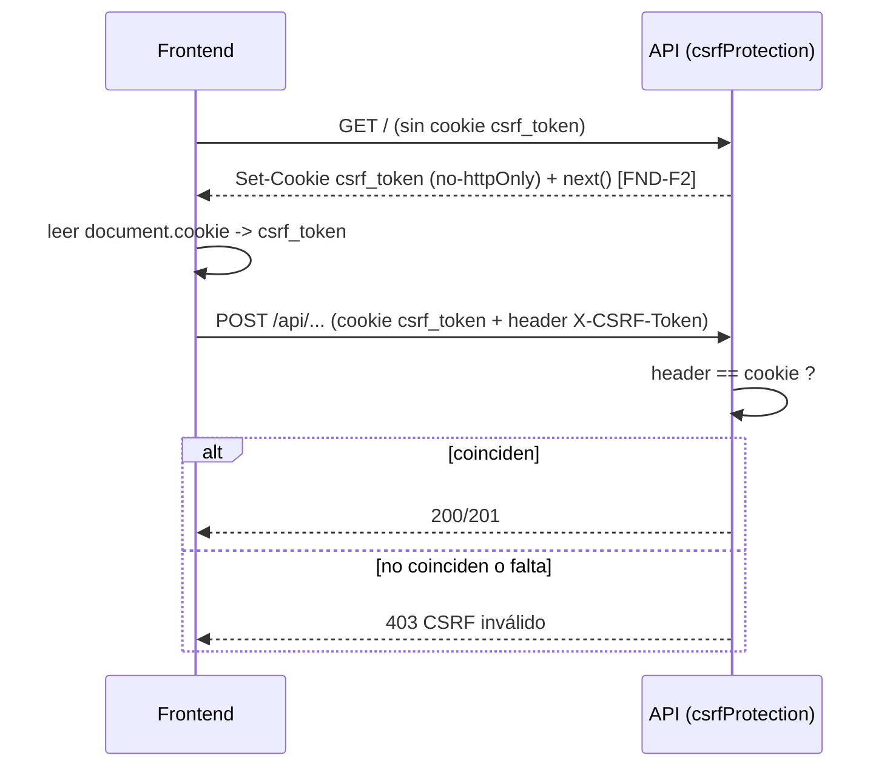
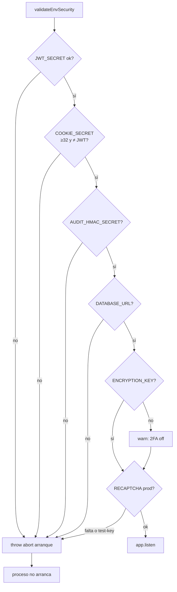
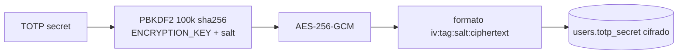

# SUB-4 — Diagramas

Índice de diagramas (Mermaid) del subsistema de Seguridad transversal.

> Vista general: `[[../../01-system-context]]` · Detalle multi-tenant: `[[../multi-tenancy/overview]]` · Auth: `[[../auth/overview]]`

## D1. Cadena de seguridad por petición

## D2. CSRF double-submit

## D3. Validación de entorno/secretos

## D4. Almacenamiento de secretos TOTP

