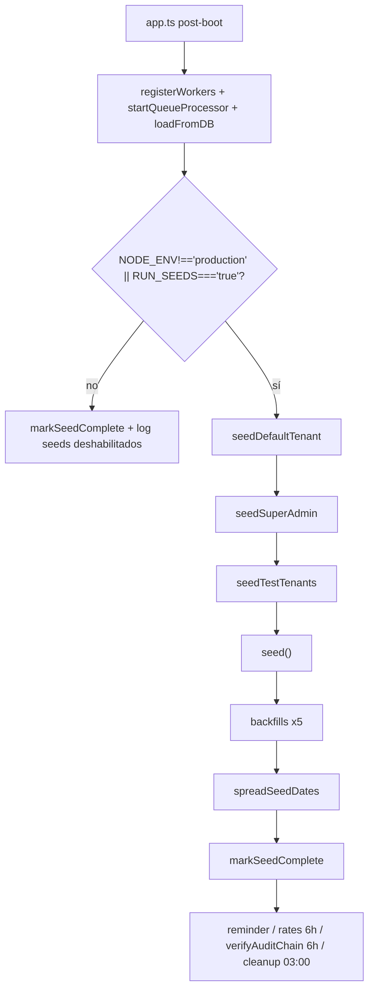
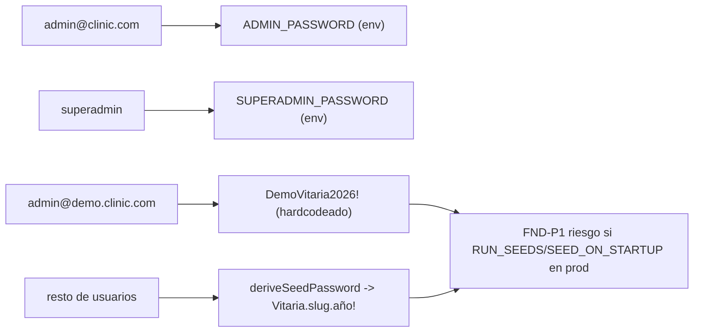
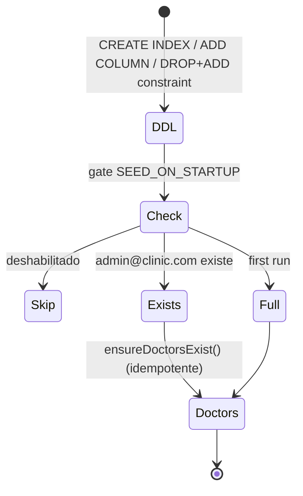
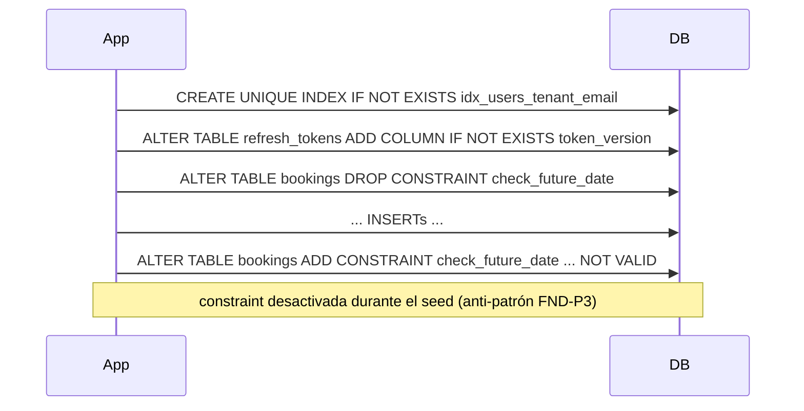

# SUB-18 — Diagramas

> Formato Mermaid (decisión D-1). Fuente: `src/seed/*`, `src/app.ts`.

## D1. Orquestación de arranque

## D2. Credenciales de seed

## D3. Ciclo idempotente de seed()

## D4. DDL en runtime (efecto lateral)

