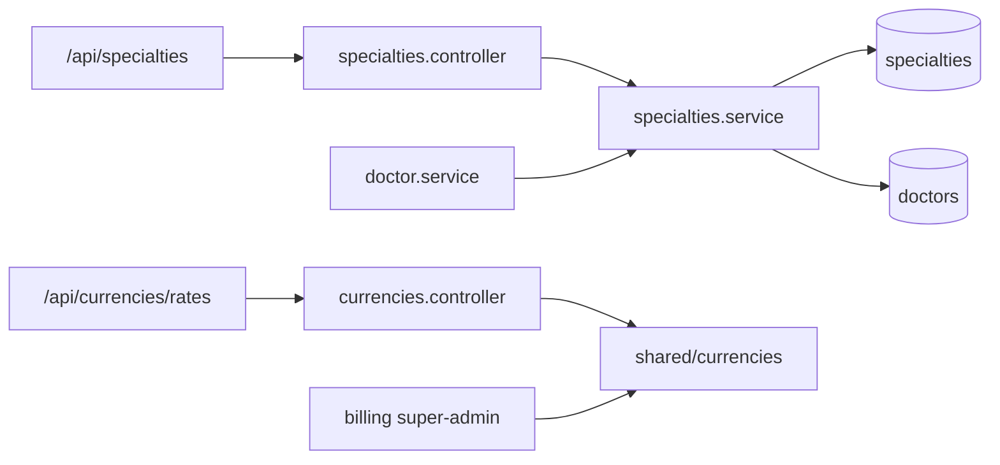
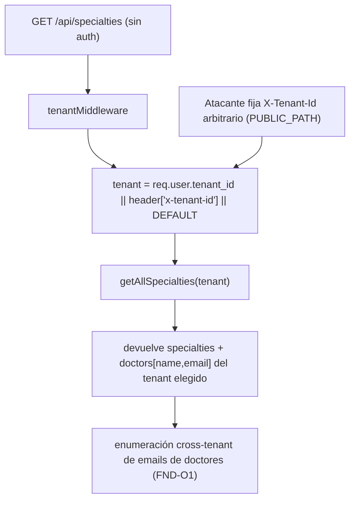
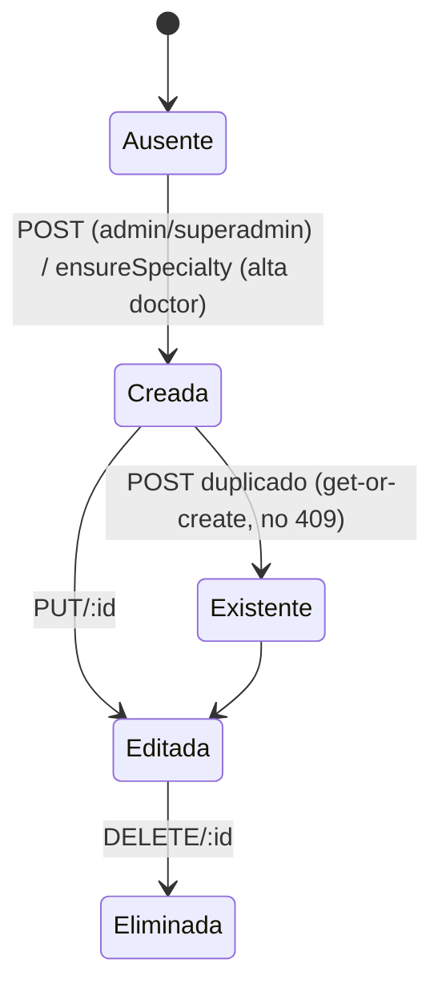
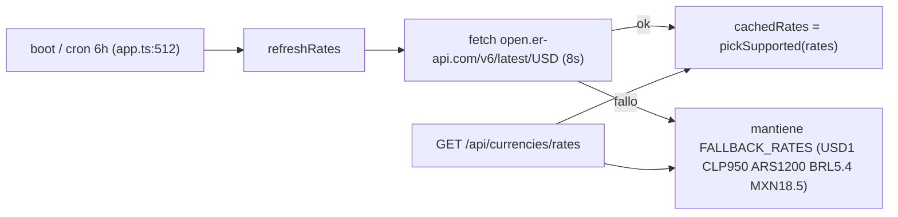

# SUB-17 — Diagramas

> Formato Mermaid (decisión D-1). Fuente: `src/modules/specialties/*`, `src/modules/currencies/*`, `src/shared/currencies.ts`, `db/init.sql`.

## D1. Módulos, rutas y tablas

## D2. Resolución de tenant en rutas públicas (riesgo O1)

## D3. Ciclo de la especialidad

## D4. Tasas de cambio

