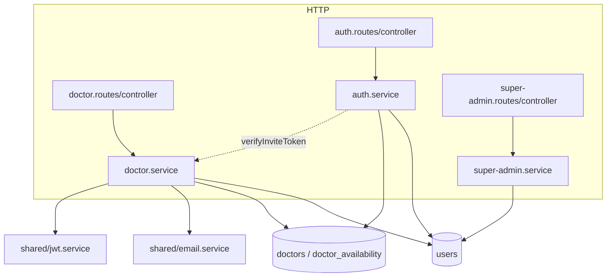
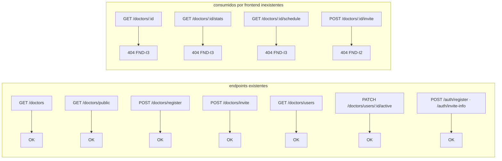
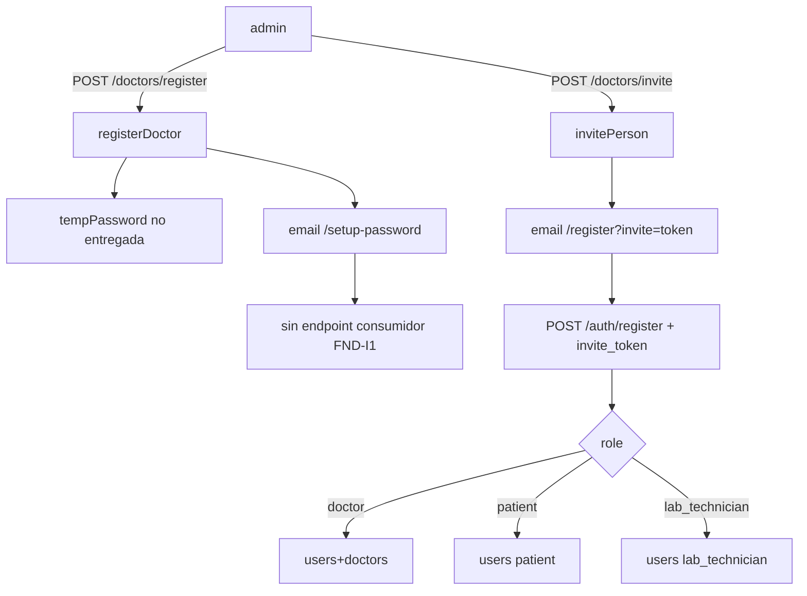
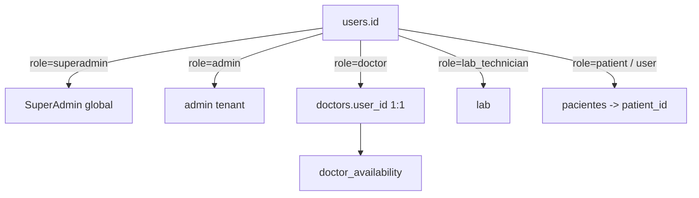
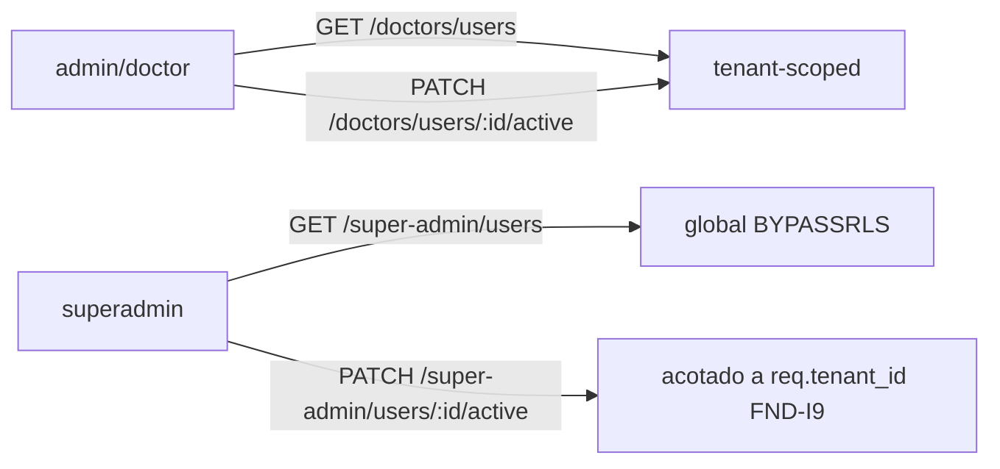

# SUB-5 — Diagramas

Índice de diagramas (Mermaid) del subsistema Usuarios, doctores y pacientes.

> Vista de datos: `[[../database/overview]]` · Auth: `[[../auth/overview]]` · Multi-tenancy: `[[../multi-tenancy/overview]]` · Contexto: `[[../../01-system-context]]`

## D1. Módulos y tablas

## D2. Rutas del frontend vs endpoints reales

## D3. Alta de doctor e invitación (dos caminos)

## D4. Identidad y roles

## D5. Gestión de usuarios: dos módulos

