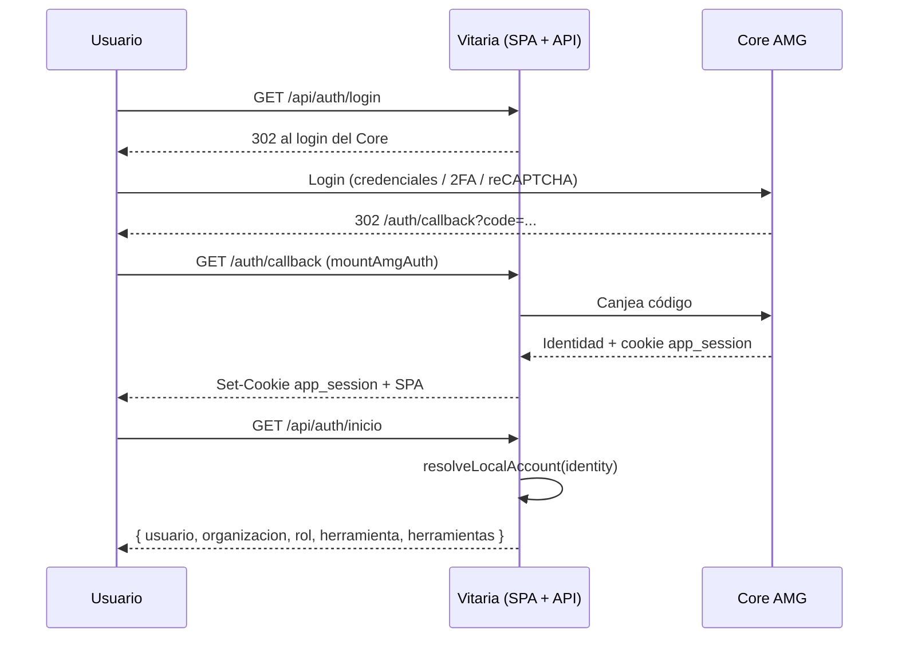

# Autenticación

> SSO con el Core AMG. Sincronizado: 2026-11-02.

## Modelo actual

Vitaria **no autentica usuarios**: delega la identidad al **Core AMG** mediante el paquete `@amg/auth-client`.

## Componentes

| Componente | Archivo | Función |
|------------|---------|---------|
| Config SSO | `src/sso/amgSso.ts` | `loadConfig(process.env, 'vitaria')`; fail-fast si falta el secreto |
| Guard | `src/sso/amgSso.ts` | `mountAmgAuthMiddleware()` valida `app_session` y deja `req.amg` |
| Rutas | `src/sso/amgSso.ts` | `/api/auth/login`, `/api/auth/me`, `/api/auth/inicio` |
| Cuenta local | `src/sso/localAccount.ts` | `resolveLocalAccount(identity)` → usuario + organización |
| Auth local | `src/modules/auth/` | Solo `register` (invitación) e `invite-info` |

## Variables de Entorno

| Variable | Uso |
|----------|-----|
| `CORE_URL` | URL base del Core AMG |
| `APP_URL` | URL pública de Vitaria (return_to / callback) |
| `AMG_SSO_CLIENT_ID` | Client ID registrado en el Core |
| `AMG_SSO_CLIENT_SECRET` | Secreto del cliente SSO |
| `COOKIE_SECRET` | Firma de cookies (independiente de `JWT_SECRET`) |
| `INVITE_JWT_SECRET` | Tokens de invitación de personal |

## Rutas Públicas (sin sesión)

`amgPublicPaths` en `src/sso/amgSso.ts`: health, métricas, favicon, assets, `/api/auth/login`, `/api/auth/register`, `/api/auth/invite-info`, planes SaaS, webhooks de Mercado Pago, tipos de cambio, doctores públicos, especialidades, slots disponibles, guest booking y confirmación.

## Alta por Invitación

1. `GET /api/auth/invite-info` valida el token de invitación.
2. `POST /api/auth/register` crea la cuenta local (doctor/laboratorio).
3. El usuario inicia sesión después por SSO con el Core.
4. Rate limit: 10 req / 15 min.

## CSRF

- Double-submit: cookie `csrf_token` + header `X-CSRF-Token`.
- El cliente Axios inyecta el header en métodos distintos de GET/HEAD/OPTIONS.
- `withCredentials: true` y CORS restringido a orígenes autorizados.

## Sesiones y Actividad

- La sesión real la mantiene el Core (`app_session`).
- Vitaria registra actividad local (`user_sessions`, `trackActivity` con throttle de 5 min).
- Un `401` en el SPA limpia el usuario y redirige una sola vez al login del Core.

## 2FA / reCAPTCHA

- Gestionados por el Core durante el login.
- Se conservan `crypto.service.ts` y `captcha.service.ts` para flujos internos y verificación server-side.

---

Tags: #seguridad #autenticacion #sso #core
